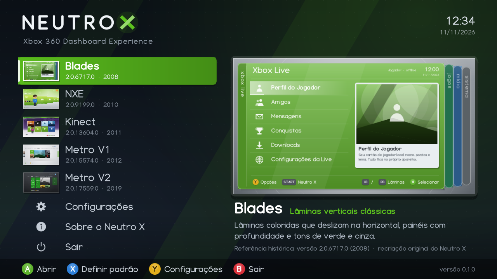
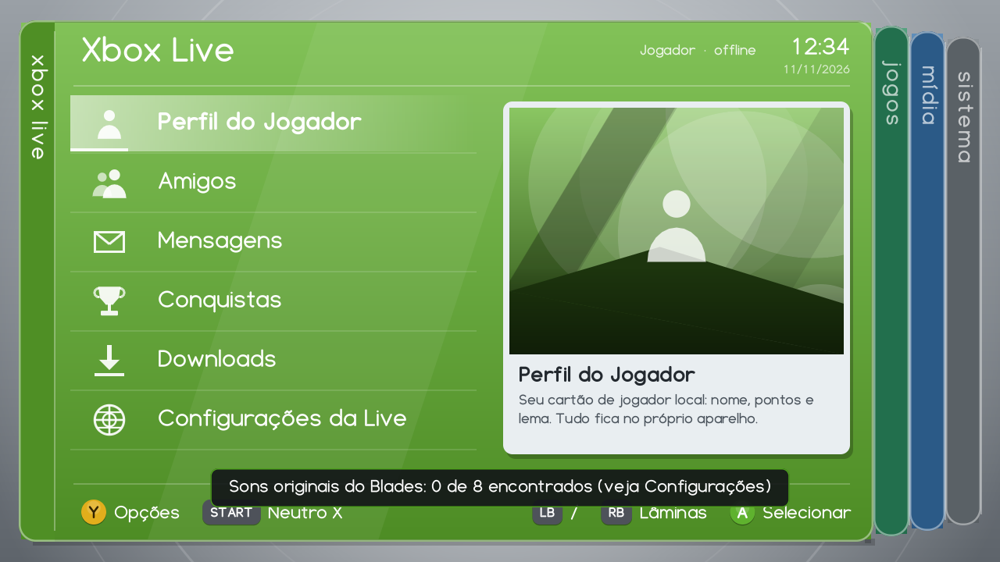
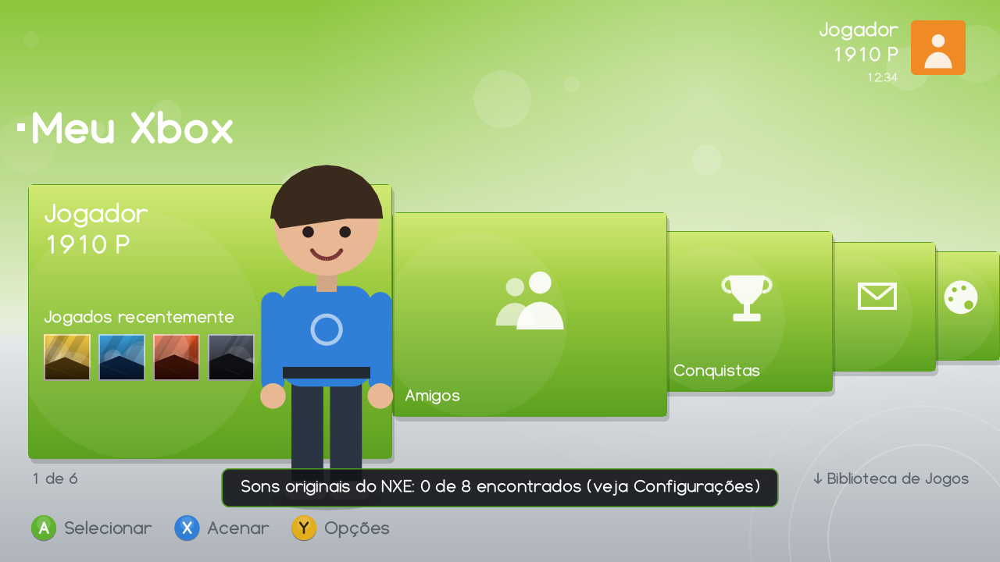
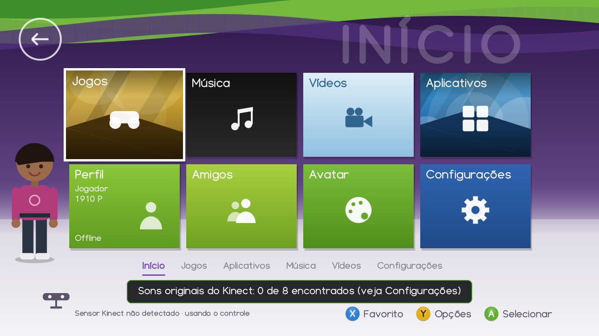
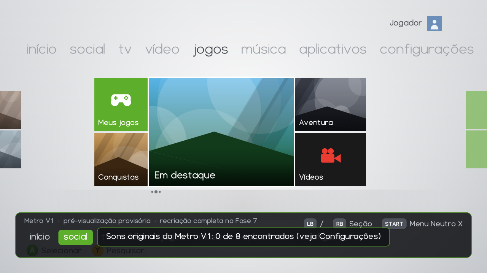
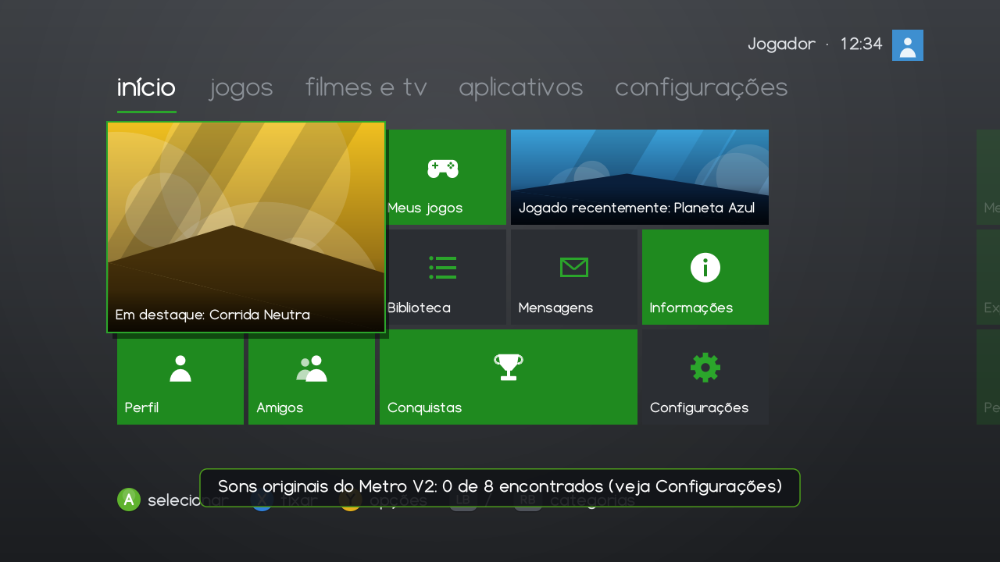
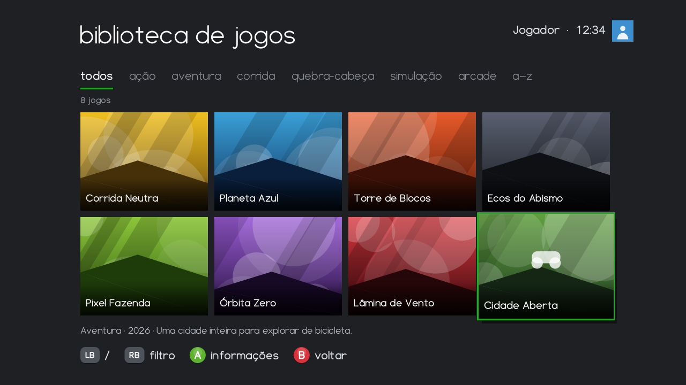

# Neutro X — Xbox 360 Dashboard Experience

Aplicativo independente que apresenta **recriações visuais e interativas** de cinco gerações
de dashboards do Xbox 360, navegáveis pelo controle e trocáveis sem reiniciar:

| Interface | Referência histórica | Ano |
|---|---|---|
| Blades | 2.0.6717.0 | 2008 |
| NXE | 2.0.9199.0 | 2010 |
| Kinect | 2.0.13604.0 | 2011 |
| Metro V1 | 2.0.15574.0 | 2012 |
| Metro V2 | 2.0.17559.0 | 2019 |

> **Status: 0.9.1-beta, Fase 10.** A revisão incorpora o log do Xbox 360 da versão
> 0.9.0. Há uma compilação XEX e um pacote local com os sons verificados do Metro V2.
> O próximo teste em hardware está descrito no [roteiro de instalação](docs/INSTALACAO_XBOX.md).
> Consulte o [relatório da revisão](docs/RELATORIO_091.md) para conferir os resultados no PC.

| Novidade 0.9.0 | Documento |
|---|---|
| Sair: **Voltar ao Aurora / Voltar ao Xbox Dashboard / Cancelar**, por troca de aplicativo (sem reiniciar o console) | [docs/SAIDA_E_INICIALIZACAO.md](docs/SAIDA_E_INICIALIZACAO.md) |
| Renderização 3–9× mais rápida nas primitivas pesadas + rasterização em 6 threads no console; medição de quadros lentos | [docs/DESEMPENHO.md](docs/DESEMPENHO.md) |
| Diagnóstico de som (saída, mixer, efeitos mudos), teste de saída, instalador por FTP dos sons locais | [docs/SONS.md](docs/SONS.md) |
| **Meus Jogos:** busca nas pastas (default.xex, GOD, XBLA), favoritos, pesquisa, detalhes, Jogar, capas do XboxUnity, aparência por interface | [docs/BIBLIOTECA.md](docs/BIBLIOTECA.md) |
| Nome do perfil conectado (somente leitura) nas interfaces | [docs/LIMITACOES.md](docs/LIMITACOES.md) |















## Princípios

- **Tudo original:** gráficos, ícones, fonte e sons são criados por código para o Neutro X.
  Nenhum recurso, código ou arquivo proprietário dos dashboards é usado ou redistribuído.
- **Seguro e reversível:** não grava na NAND, não altera arquivos do sistema, não mexe na
  inicialização nem no RGH. Desinstalar = apagar a pasta do aplicativo.
- **Sons originais só por conta do usuário:** se você tiver os áudios originais e permissão
  para usá-los, coloque-os numa pasta local; eles nunca entram no repositório.
  Ver [docs/SONS.md](docs/SONS.md).

## Executar a prévia no Windows

Baixe o ZIP da [página de releases](../../releases) e execute `NeutroX.exe`
(Windows 10/11 x64; não precisa instalar nada).

| Controle Xbox 360 | Teclado | Ação |
|---|---|---|
| Direcional / analógico esq. | Setas ou W A S D | Mover seleção |
| A | Enter / Espaço | Confirmar |
| B | Esc / Backspace | Voltar |
| X | X | Ação contextual (no menu: definir dashboard padrão) |
| Y | Y | Opções |
| LB / RB | Q / E | Trocar categoria |
| START | Tab | Menu do Neutro X (dentro de um dashboard) |
| BACK | F1 | Mostrar/ocultar FPS |
| — | F12 | Captura de tela (PNG na pasta de dados) |

Pasta de dados (configurações, log, capturas, sons originais): `%LOCALAPPDATA%\NeutroX\`.

Opções de linha de comando: `--res 1920x1080`, `--data PASTA`, `--mute`,
`--frames N --screenshot arquivo.png` (teste automatizado).

## Compilar

Requisitos: CMake ≥ 3.20 e um compilador C++17 (testado com Visual Studio 2022).

```bash
cmake -S . -B build -G "Visual Studio 17 2022" -A x64
```

```bash
cmake --build build --config Release
```

```bash
build/Release/neutrox_tests.exe build/test_output
```

Os testes rodam sem janela, gravam capturas PNG de cada tela em `build/test_output/` e
verificam inicialização, controle, as cinco interfaces, troca repetida (100×), memória,
desempenho, configurações, recuperação de erros e encerramento.

## Estrutura

```text
src/core/        loop principal, pilha de telas, transições, log, PNG
src/graphics/    IRenderer, renderizador em software, fonte vetorial própria, ícones, UI
src/input/       abstração do controle (repetição, analógico, desconexão)
src/audio/       mixer, temas sonoros por versão, carregador de sons originais (WAV)
src/settings/    configurações (arquivo próprio neutrox.ini, gravação atômica)
src/library/     Meus Jogos: cabeçalhos XEX2/STFS, busca, biblioteca.ini, capas (XboxUnity)
src/net/         cliente HTTP mínimo (capas)
src/system/      saída para o Aurora/dashboard (launch.ini só leitura)
src/dashboards/  registro e telas das cinco interfaces
src/shell/       menu inicial, configurações, Meus Jogos, pastas, teclado, menu START, diálogos
src/platform/    win32 (prévia), headless (testes), xbox360 (xsdk)
assets/          sons recriados exportados em WAV, por versão
tools/           xex_inspect.py (cabeçalho), xex_unpack.cpp + sound_extract.py (extração local de
                 sons originais), xbox_install.py (envio por FTP ao console), glyph_check.py,
                 exportador de sons recriados
docs/            relatórios, arquitetura, toolchain, limitações, fases
tests/           testes automatizados (fixtures/: imagens sintéticas de teste)
```

## Documentação

- [Relatório da Fase 1](docs/RELATORIO_FASE1.md) — análise do pacote, XEX, imagens, áudio
- [Arquitetura](docs/ARQUITETURA.md)
- [Ferramentas de compilação e porta para o console](docs/TOOLCHAIN.md)
- [Instalar e testar no Xbox 360 (Aurora)](docs/INSTALACAO_XBOX.md)
- [Saída e início de jogos](docs/SAIDA_E_INICIALIZACAO.md)
- [Meus Jogos (biblioteca e capas)](docs/BIBLIOTECA.md)
- [Desempenho](docs/DESEMPENHO.md)
- [Sons](docs/SONS.md)
- [Relatório de áudio dos cinco XEX](docs/RELATORIO_AUDIO_XEX.md)
- [Relatório de testes](docs/RELATORIO_TESTES.md)
- [Limitações](docs/LIMITACOES.md)
- [Fases](docs/FASES.md)

## Aviso legal

Xbox, Xbox 360, Xbox LIVE e Kinect são marcas da Microsoft Corporation. O Neutro X é um
projeto de fã, sem afiliação ou endosso da Microsoft. Código sob licença [MIT](LICENSE).
